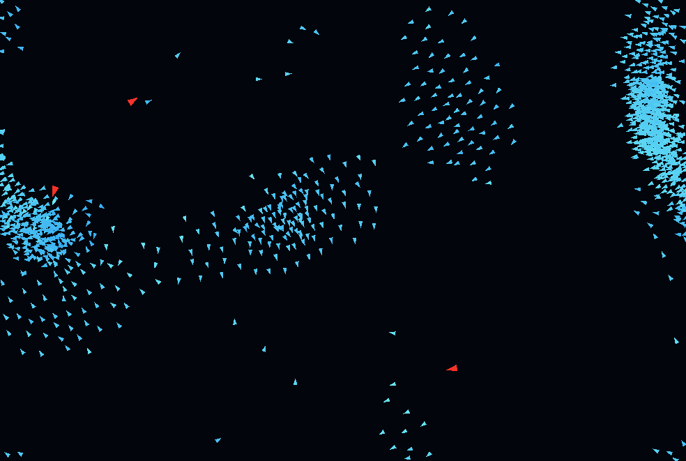

# Boids Screensaver

Standalone Windows `.scr` screen saver with a C++17 flocking simulation and
OpenGL rendering.




## Design

- Standard Windows screen-saver modes: `/s`, `/p <HWND>`, `/c`, `/w`, `/d`
- Full-screen mode covers the virtual desktop across connected monitors
- Fixed 60 Hz simulation step, independent from render cadence
- OpenGL double-buffered triangle rendering
- CPU spatial grid for local neighbor search
- Dense-flock protection: each prey samples at most 96 local candidates per update
- Three red predators: hunt closest visible prey; prey flee their danger radius
- Two-buffer simulation update: all boids read one stable frame, then commit
  their next states together
- Optional OpenMP parallel force calculation for development builds
- Solid walls by default: a distance-based soft force starts 100 px from each wall and grows toward it; only the physical screen edge is a hard boundary; wrap-around remains configurable in code

The flocking design is informed by
[`rystrauss/boids`](https://github.com/rystrauss/boids), an MIT-licensed C++
boids implementation. This project has a standalone Win32/OpenGL implementation.
See [NOTICE.md](NOTICE.md) for attribution.

## Run modes

```text
boids.scr /s        Full-screen screen saver
boids.scr /p <HWND> Control-panel preview host
boids.scr /c        Persisted settings panel (also accepts Windows' /c:<HWND> form)
boids.scr /w        Resizable live-adjustment window
boids.scr /d        Full-screen debug path
```

In `/s` mode, keyboard input, mouse clicks, or meaningful mouse motion closes
the screen saver.

## Build

### MSYS2 UCRT64

Install a C++ toolchain, CMake, and GNU Make. Open a UCRT64 terminal, then:

```sh
cd /d/Coding/boids-screensaver
cmake -S . -B build -G "MinGW Makefiles" -DCMAKE_BUILD_TYPE=Release
cmake --build build --parallel
ctest --test-dir build --output-on-failure
```

Output:

```text
bin/boids.scr
```

For MinGW builds, CMake statically links its C/C++ runtime by default.
`build.bat` disables optional OpenMP so the shipped `boids.scr` needs only
normal Windows system DLLs. Development builds can opt into OpenMP:

```sh
cmake -S . -B build -G "MinGW Makefiles" -DBOIDS_SCREENSAVER_ENABLE_OPENMP=ON
```

An OpenMP-enabled build needs `libgomp-1.dll` next to `boids.scr` on PCs
without MSYS2.

`build.bat` tries an MSVC environment first, then an MSYS2 UCRT64 environment.

## Test

The `/c` control panel (including Windows' `/c:<HWND>` invocation) saves these
per-user settings in `HKCU\\Software\\Qink\\BoidsScreensaver`; saved values
affect later `/s`, `/w`, and `/d` launches. In `/w`, the same non-modal panel
opens beside the renderer; each **Save** persists its values and immediately
recreates the displayed flock with them. The small `/p` preview deliberately
remains capped at 120 birds. Available settings: solid walls, bird count,
predator count, bird speed, predator speed ratio, soft-wall range, soft-wall
strength, and restore defaults.

The core simulation test checks:

- deterministic fixed-step state evolution, including dense capped flocks;
- position and speed invariants after long runs;
- control-panel setting limits;
- empty flock and resize behavior.

```sh
ctest --test-dir build --output-on-failure
```

## Current limits

This initial version uses legacy OpenGL immediate-mode triangles for portability
and a compact codebase. Future work can replace this path with VBO/instanced
rendering.

## License

MIT. See [LICENSE](LICENSE).
